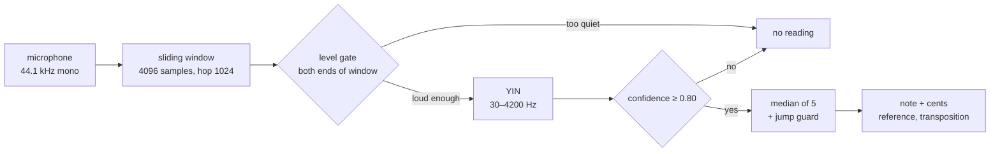
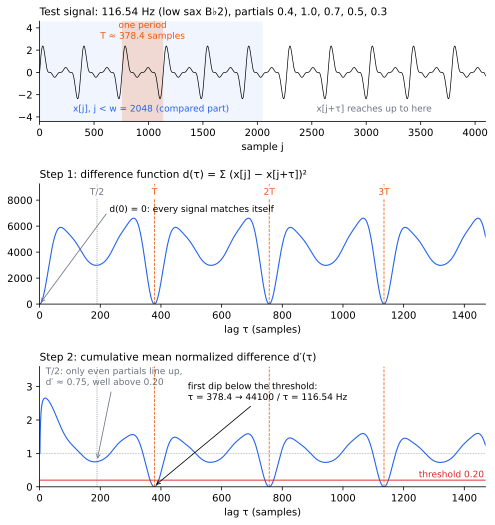
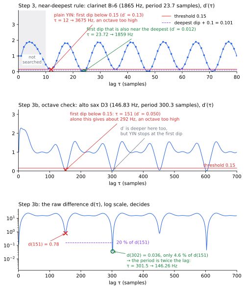
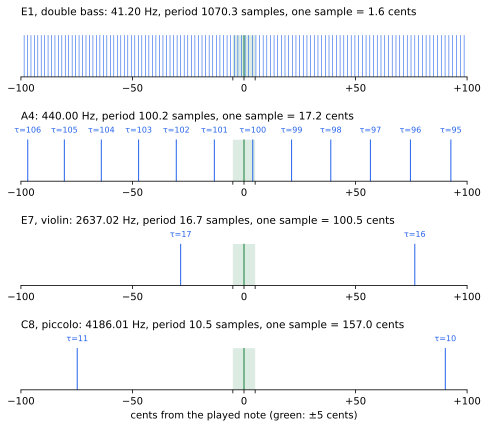
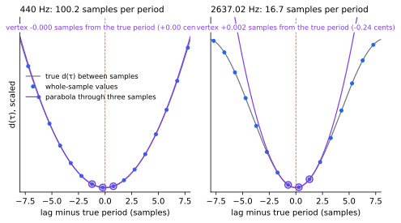
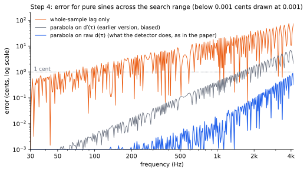

# Pitch detection

This document explains how Tune the World turns microphone samples into a note and a deviation in cents. It says which parts come from published methods, which are this project's own additions, and why each one is there. The short version is in the [README](README.md#how-it-works). The figures are drawn from the app's own code; [docs/plots/README.md](docs/plots/README.md) explains how to regenerate them. All constants live in [TunerConfig.kt](app/src/main/java/de/example/tunetheworld/engine/TunerConfig.kt).

The core is the YIN algorithm [1], with the difference function computed by FFT [1, 3, 4], a first-dip rule borrowed from the McLeod Pitch Method [2], an octave check for low notes, and median smoothing [5].

## Overview



| Stage | Code |
|---|---|
| Audio input | [AudioInput.kt](app/src/main/java/de/example/tunetheworld/audio/AudioInput.kt) |
| Window, gate, confidence filter | [PitchPipeline.kt](app/src/main/java/de/example/tunetheworld/dsp/PitchPipeline.kt) |
| YIN | [YinPitchDetector.kt](app/src/main/java/de/example/tunetheworld/dsp/YinPitchDetector.kt) |
| Difference function by FFT | [DifferenceFunction.kt](app/src/main/java/de/example/tunetheworld/dsp/DifferenceFunction.kt) |
| Smoothing | [PitchSmoother.kt](app/src/main/java/de/example/tunetheworld/dsp/PitchSmoother.kt) |
| Note and cents | [NoteMapper.kt](app/src/main/java/de/example/tunetheworld/music/NoteMapper.kt) |

All DSP code is plain Kotlin without Android dependencies, so the same code runs in the app and in the JVM unit tests against real recordings. Arrays are allocated once; the per-block path allocates nothing except the small result object.

## 1. Audio input

The app records mono float samples at 44.1 kHz. It asks for the `UNPROCESSED` audio source where the device supports it and falls back to `VOICE_RECOGNITION`. It never uses `MIC`: on many phones that source turns on noise suppression and automatic gain control, which can distort the waveform and pump the level.

## 2. Window and level gate

Analysis runs on a sliding window of 4096 samples (about 93 ms). Every 1024 new samples (about 23 ms), the window moves on and is analysed again, about 43 times per second.

Why 4096: YIN compares the signal with a copy of itself shifted by up to one period. The integration window is half the buffer, w = 2048 samples. The longest period searched is 1470 samples (30 Hz). Together they need 2048 + 1471 = 3519 samples, so 4096 is the next power of two that fits. This follows the paper's rule that the integration window must be at least as long as the longest period to be detected, so the signal covers about twice that period [1, section IV]. A longer window would be steadier but slower to react.

**Level gate.** Below a configurable level (−40 dBFS by default, adjustable from −60 to −30 dBFS) nothing is analysed. The gate checks the RMS level of both the newest and the oldest 1024 samples in the window. Checking only the newest block is not enough: in the first blocks of a note, the window still contains the silence before it, and YIN reports unreliable pitches for those blocks. This rule is our own addition.

## 3. YIN

YIN was published by de Cheveigné and Kawahara in 2002 [1]. It is a time-domain method: instead of looking for peaks in a spectrum, it looks for the lag τ at which the signal best matches a shifted copy of itself. That lag is the period, and the frequency is sample rate / τ.

The search covers lags from τ_min = ⌊44100 / 4200⌋ = 10 to τ_max = ⌈44100 / 30⌉ = 1470 samples, which is 30 Hz (just below B0, the lowest string of a five-string bass) to 4200 Hz (just above C8, the top of the piccolo).

### Step 1: difference function

```
d(τ) = Σ_{j=0}^{w−1} (x[j] − x[j+τ])²
```

d(τ) is zero when the signal repeats exactly after τ samples and small when it nearly repeats. This is step 2 of the paper. The paper's step 1, plain autocorrelation, is the starting point it improves on and is not used here. Computing d directly takes w · τ_max ≈ 3 million multiply-adds per analysis; [section 4](#4-the-difference-function-by-fft) explains how the FFT avoids that.

### Step 2: cumulative mean normalized difference (CMND)

```
d′(0) = 1
d′(τ) = d(τ) / ((1/τ) · Σ_{j=1}^{τ} d(j))
```

Raw d(τ) starts at zero for τ = 0 and dips at every multiple of the period, so the smallest value is not a reliable pick. Dividing by the running mean removes the dip at zero and puts all dips on one scale: values near 0 mean "very periodic at this lag", values near 1 mean "no better than average". This is step 3 of the paper.



The figure shows both functions for one test signal from [YinPitchDetectorTest](app/src/test/java/de/example/tunetheworld/dsp/YinPitchDetectorTest.kt) (`saxLikeLowToneIsNotAnOctaveHigh`). It is a low B♭2 at 116.54 Hz whose second partial is louder than the fundamental, as on a real low saxophone note. The values come from the app's own `DifferenceFunction`, run on the full 4096-sample buffer.

- **Signal (top):** the period is T = 44100 / 116.54 ≈ 378.4 samples. The first w = 2048 samples (shaded blue) are compared with copies of the signal shifted by τ.
- **d(τ) (middle):** zero at τ = 0, then nearly zero again at T, 2T and 3T, where the signal lines up with itself. It is not exactly zero there, because the true period falls between two whole samples. Step 4 deals with that. At T/2 only the even partials line up, which gives a partial dip.
- **d′(τ) (bottom):** starts at 1 by definition. The dip at T/2 stays at about 0.75, far above the threshold. The first dip below 0.15 is at τ = 378, and interpolation refines it to 378.4 samples. The detector reports 116.540 Hz with a confidence of 0.9998. The deeper dips at 2T and 3T are never considered, because the first dip below the threshold wins.

### Step 3: choosing the dip

YIN's absolute threshold (step 4 of the paper) takes the first lag where d′ drops below a threshold, here 0.15, and then walks down to the bottom of that dip. The paper calls the error this prevents a subharmonic or "octave" error: a dip at two or three times the period can be deeper than the one at the period itself, and picking it reads an octave or a twelfth too low. Taking the first dip below the threshold, rather than the deepest one, avoids this. The paper uses a threshold of 0.1 and found that the exact value hardly matters (its Fig. 4b).

**Near-deepest rule.** Plain YIN can go wrong the other way on high notes. For the clarinet's B♭6 in the test recordings, d′ is 0.14 at half the period, just under the threshold, and 0.01 at the true period. Plain YIN would read an octave too high. So a dip is only accepted if it is also within 0.1 of the deepest dip in the search range:

```
accept = min(0.15, deepest + 0.1)
```

The idea comes from the McLeod Pitch Method [2], which accepts the first peak of its normalized function that reaches a fixed fraction of the highest peak. Here it is applied to YIN's d′ as an additive margin.

Unlike the paper, which falls back to the global minimum when nothing is below the threshold, the detector reports no pitch in that case. A tuner showing nothing is better than one showing a guess.

### Step 3b: octave check for low notes

On low notes the fundamental is often much weaker than the second harmonic: low strings, the saxophone's low register, and notes dying away. The signal then nearly repeats after half the period, d′ dips below the threshold there first, and the reading is an octave too high.

The check: if the chosen lag is 100 samples or more (below about 440 Hz) and its d′ is above 0.005, look at twice the lag (the smallest raw d within ±2 samples of it). If the raw difference there is less than a fifth of the raw difference at the chosen lag, twice the lag is taken as the period.

The conditions come from testing against the recordings:

- **Raw d, not d′.** d′ divides by the running mean, which grows with τ, so it favours longer lags. Comparing d′ values pushed clean high notes down an octave.
- **Only for lags of 100 or more.** At short lags the true period usually falls between whole samples. Twice the period can then land almost exactly on a whole sample and look deeper by chance. The violin's E7 has a period of 16.7 samples: lag 16 gives a shallow dip and lag 33 a deep one, although 16.7 is correct.
- **Only when the first dip is above 0.005.** On a clean tone both dips are close to zero, and their ratio is just noise.

This check is our own heuristic, not taken from a paper. With it, all test recordings pass.

It is not perfect. In 8 single analysis blocks of 4 recordings (violin A4, oboe A4, trumpet E3, trombone E2), it moves a correct reading an octave down. In those blocks the first dip is only just above the 0.005 limit (at most 0.012), while the real octave errors it fixes start at 0.045. Raising the limit to about 0.03 would probably separate the two groups, but that has not been tried yet. The wrong blocks never reach the display: none of them come three in a row, so the smoother's jump guard ([section 6](#6-smoothing)) holds them back.

One known limit remains: as the cello's C2 fades out, its fundamental almost disappears, and the end of the note still reads an octave up. The tests tolerate that in the fade-out only.



The figure shows both rules on real recordings from the test set. Each panel shows one 4096-sample analysis window.

- **Clarinet B♭6 (top).** At half the period (τ = 12), d′ is 0.13, just under the threshold. Plain YIN stops there and reads about 3675 Hz, an octave too high. The deepest dip is 0.0015, so only dips below 0.101 are accepted. The first such dip is at τ = 24, which interpolation refines to 23.72 samples: 1859 Hz.
- **Alto sax D3 (middle).** The second harmonic is stronger than the fundamental. d′ first drops below the threshold at τ = 151, half the period, with d′ = 0.05. That passes the near-deepest rule too, so on its own the detector would read about 292 Hz. d′ is even deeper at τ = 302, but YIN takes the first dip.
- **Alto sax D3, raw d on a log scale (bottom).** The octave check applies because the lag is 151 (at least 100) and d′ = 0.05 (above 0.005). d(302) is 4.6 % of d(151), well below the 20 % limit, so 302 is taken as the period: 146.26 Hz. The expected pitch is 146.83 Hz. On a log scale the 20 % limit is a fixed distance below d(151), drawn as the dashed line.

### Step 4: parabolic interpolation

**Why whole samples are not enough.** The difference function only exists at whole-sample lags, and the frequency is f = 44100 / τ. Whole lags can only express a fixed set of frequencies. Two neighbouring lags τ and τ + 1 are 1200 · log2((τ + 1) / τ) ≈ 1731 / τ cents apart, so the gap grows as the period gets shorter:



Each blue line is a frequency the tuner could show without interpolation; the green band is ±5 cents around the played note.

- **E1 (double bass):** a period of 1070 samples. Neighbouring lags are 1.6 cents apart, almost fine enough on their own.
- **A4:** neighbouring lags are 17 cents apart. Even an exact 440 Hz could only be shown as +3.9 cents (lag 100 is 441 Hz), and the needle would move in 17-cent jumps.
- **E7 (violin):** the two nearest lags are 28 cents flat and 76 cents sharp. The sharp one is already closer to the next note up.
- **C8 (piccolo):** the nearest lags are 75 cents flat and 90 cents sharp. Neither shows C8 at all.

A tuner needs a resolution of a cent or two everywhere. Upsampling the signal would also help, but every factor of upsampling multiplies the number of lags to compute. Interpolating between the three values around the dip costs only a handful of operations.

**How.** Fit a parabola through the dip's value s₀ at the whole lag τ and its neighbours s₋ at τ − 1 and s₊ at τ + 1. Written in terms of the offset x from τ, it is p(x) = a·x² + b·x + s₀ with a = (s₋ − 2s₀ + s₊) / 2 and b = (s₊ − s₋) / 2. Its minimum, at x = −b / 2a, is the refined period. Like step 5 of the paper, the detector fits the parabola to the raw difference d (why not d′ is explained below):

```
τ_refined = τ + ½ · (d(τ−1) − d(τ+1)) / (d(τ−1) − 2·d(τ) + d(τ+1))
f = 44100 / τ_refined
```

**Why a parabola.** At the bottom of any smooth dip the slope is zero, so close to it the curve is approximately d(τ₀) + ½·d″(τ₀)·(τ − τ₀)², a parabola (a Taylor expansion). For a pure sine of amplitude A, d(τ) is close to w·A²·(1 − cos(2πτ/T)): a cosine in τ, whose bowl is nearly a parabola. The approximation only holds near the bottom, which leads to the limit shown here:



For a synthetic sine, the shifted signal can be computed for any fractional lag, so the true curve between the samples (grey) is known exactly. The blue dots are the detector's own whole-sample values, and the purple parabola goes through the three circled ones.

- **440 Hz, 100 samples per period:** the three points cover a tiny part of the bowl. Over the whole ±8 samples shown, the parabola and the true curve can't be told apart, and its minimum is within 0.001 samples of the true period.
- **2637 Hz, 16.7 samples per period:** the bowl is only a few samples wide. Beyond about ±2 samples the parabola bends away from the true curve. Its minimum is still close, 0.002 samples off (0.24 cents), but the fewer samples per period, the larger the part of the bowl the three points cover, and the larger the error.

The paper makes the same argument [1, section II E]. The autocorrelation of a band-limited signal is a sum of cosines, and its Taylor expansion has only even powers. The terms of degree 4 and higher come from the highest frequencies, so the parabola is accurate unless the signal has strong components above about a quarter of the sample rate. The paper also notes that interpolation is much cheaper than upsampling.

**Why raw d and not d′.** The dip is found on d′ (step 3), so fitting the parabola to d′ seems natural, and the detector did that until November 2026. The paper warns against it. Its step 5 fits parabolas to d′ to compare the dips, but takes the period from raw d [1, section II E]: "one finds that the estimate obtained in this way is slightly biased. To avoid this bias, the abscissa of the corresponding minimum of the raw difference function d(τ) is used instead."

The bias comes from the normalization. d′(τ) = d(τ) · τ / Σ d(j). Around the dip the sum hardly changes, so d′ is roughly d multiplied by a factor that grows in proportion to τ. That factor tilts the bowl and pulls the minimum towards shorter lags, so readings come out sharp. The tilt matters more at short lags: one sample changes τ by 6 % at a period of 16.7 samples, but by only 1 % at 100. The sweep below shows the result. On the test recordings, switching to raw d moved readings flat by about 1 cent for the highest notes (median shift: violin E7 1.4 cents, flute C7 1.0, oboe G6 0.9), and by a median of less than 0.1 cents for notes below about 500 Hz. No reading switched between "note" and "no note".

The paper uses interpolation for a second purpose that the detector also skips. It interpolates the depth of every dip before comparing it with the threshold, because at high frequencies a dip sampled at whole lags can look shallower than it really is. The detector compares the sampled values directly, which is fine so far: with all 42 recordings passing, no case has turned up where this matters. A candidate for later.



The figure shows the error for pure sines at 400 frequencies from 30 Hz to 4186 Hz:

- **Whole-sample lag alone (orange):** off by up to 1.6 cents below 100 Hz and up to 75 cents at the top. For the 2637 Hz sine, the dip at τ = 17 gives 2594 Hz, 28 cents flat.
- **Parabola on raw d (blue), what the detector does:** at most 0.02 cents below 1 kHz and 0.9 cents at the top, with no systematic offset. For the 2637 Hz sine it gives 2636.66 Hz, 0.24 cents flat.
- **Parabola on d′ (grey), the earlier version:** sharp at every frequency, by 1.8 cents on average above 1 kHz and up to 7 cents above 3.6 kHz.

The paper's step 6, "best local estimate", is not used [1, section II F]. For each analysis point, it looks at the estimates of nearby analysis points (within half the longest period), takes the one with the smallest d′, and runs the search again within ±20 % of it. Here the median smoothing and jump guard in [section 6](#6-smoothing) take its place. The paper deliberately avoided median smoothing so as to evaluate the method on its own (section VIII), and it points out the difference: step 6 chooses by quality (d′), not by continuity.

### Confidence

The confidence is 1 − d′ at the chosen lag, clamped to 0–1. The paper shows that d′ at the period is proportional to the ratio of aperiodic to total power, and suggests using it as a confidence indicator [1, sections II D and V]. Readings below 0.80 are dropped. Because the threshold is 0.15, this mostly filters out cases where the octave check moved to twice the lag and the dip there is less clean.

### Differences from the paper

The paper was written and evaluated for speech, at 16 and 20 kHz. This detector is for tuning instruments at 44.1 kHz, and it differs from the paper in these points:

| | Paper [1] | This detector |
|---|---|---|
| Search range | 40 Hz to a quarter of the sample rate | 30–4200 Hz |
| Window | 25 ms, a new estimate every sample | w = 2048 samples (46 ms), a new estimate every 1024 samples |
| Low-pass prefilter | 1 ms moving average (zero at 1 kHz) in the evaluation | none; it would weaken high notes |
| Threshold (step 4) | 0.1 | 0.15 |
| No dip below the threshold | take the global minimum | report no pitch |
| Extra dip rules | none | near-deepest rule, octave check (step 3, 3b) |
| Interpolation (step 5) | depth of every dip interpolated before choosing; period taken from raw d | only the chosen dip is interpolated; period taken from raw d, as in the paper |
| Step 6, best local estimate | yes | no; median smoothing with a jump guard instead |
| Difference function | direct sum, or a recursion over time | FFT, exact for every lag |

## 4. The difference function by FFT

Expanding the square splits d(τ) into three terms, as the YIN paper notes in its equation (7) [1]:

```
d(τ) = Σ x[j]²  +  Σ x[j+τ]²  −  2 · Σ x[j]·x[j+τ]
        energy of     energy of        cross-correlation r(τ)
        the head      the shifted part
```

- The first term is the same for every τ.
- The second is a sliding sum. With prefix sums E[i] = Σ_{j<i} x[j]², it is E[τ+w] − E[τ], one subtraction per lag.
- The third is the cross-correlation of the first w samples with the whole buffer. By the correlation theorem, a correlation is a product in the frequency domain: r = IFFT(conj(A) · B), where A and B are the FFTs of the two signals [4, section 13.2]. With an FFT [3] this takes O(n log n) for all lags at once instead of O(w · τ_max).

The paper also mentions an FFT implementation [1, section V], but for its variant with a window that shrinks as τ grows (its Eq. 2). That variant needs a bias correction and makes large lags less reliable, so the paper calls it "not as good". That limitation does not apply here. The first w samples are correlated with the whole buffer, which gives the paper's Eq. (6) exactly for every lag. The result is the same as the direct loop, as [DifferenceFunctionTest](app/src/test/java/de/example/tunetheworld/dsp/DifferenceFunctionTest.kt) checks.

Implementation details in [DifferenceFunction.kt](app/src/main/java/de/example/tunetheworld/dsp/DifferenceFunction.kt):

- **FFT size 4096.** Both signals are zero-padded to n ≥ w + τ_max, so the circular correlation computed by the FFT does not wrap around into the lags that are needed.
- **Two real FFTs for the price of one.** The first w samples go into the real part and the whole buffer into the imaginary part of one complex FFT. The two spectra are separated afterwards using their symmetry [4, section 12.3]:
  ```
  A[k] = (Z[k] + conj Z[n−k]) / 2
  B[k] = (Z[k] − conj Z[n−k]) / 2i
  ```
- **Inverse by the forward transform.** The inverse FFT is computed as conj(FFT(conj X)) / n. Only the real part is needed, because the correlation of real signals is real.
- **Double precision.** Near a dip, d(τ) is a small difference of large terms, so float rounding would eat the information that matters. Values that come out slightly negative from rounding (silence, a perfectly periodic tone) are clamped to 0.
- **Radix-2, iterative, in place**, with precomputed twiddle factors and bit-reversal table. Nothing is allocated per call.

On a desktop JVM this takes about 240 µs per analysis instead of about 2.8 ms for the direct loop, roughly 12× faster. Across all 42 test recordings (5940 analysis blocks), the FFT version gives the same readings as the direct loop to within 0.002 cents, and no block changes between "note" and "no note". [DifferenceFunctionTest](app/src/test/java/de/example/tunetheworld/dsp/DifferenceFunctionTest.kt) compares it with the textbook definition, computed in double precision, on noise and harmonic tones from 32.7 Hz to 2637 Hz.

## 5. Precision and latency

Measured by the unit tests on synthetic tones:

| Pure sine | Test limit |
|---|---|
| 30.87 Hz (B0), 41.20 Hz (E1), 103.83 Hz, 440 Hz, 1000 Hz, 2637 Hz (E7), 4186 Hz (C8) | 1 cent |
| 440 Hz with added noise | 3 cents |
| harmonic tones with a weak fundamental (65.41 Hz, 116.54 Hz) | 2 cents, right octave |

The finer sweep in the [step 4 figure](#step-4-parabolic-interpolation) shows the error staying below 0.1 cents up to about 2 kHz and below 0.9 cents up to 4.2 kHz. High notes are the hardest case, because their short periods (10 samples at 4186 Hz) leave the three points covering more of the dip. On real recordings, the median block-to-block jitter of steady notes must stay at or below 3 cents; see [SampleValidationTest](app/src/test/java/de/example/tunetheworld/sample/SampleValidationTest.kt).

Latency: a reading reflects the last 93 ms of sound and is updated every 23 ms. The median of 5 adds about two hops (about 46 ms) of delay. In the recordings a note is shown within 300 ms of its first loud block, usually much sooner.

## 6. Smoothing

The detector's readings go through a median of the last 5 values [5]. A median removes single wrong readings completely, where a mean would smear them in, and it follows a real pitch change after a few blocks.

A jump guard sits in front of it: a reading more than 0.8 semitones away from the current median is held back. Only when three such readings in a row agree with each other (within 0.8 semitones) is it treated as a new note, and the median starts over from there. Single octave errors are therefore never shown. Vibrato stays visible, because it moves the pitch by much less than 0.8 semitones. The tests check that vibrato notes still show a range of at least 8 cents.

## 7. From frequency to note

```
m = 69 + 12 · log2(f / ref)      MIDI note number, ref = concert A4 (default 440 Hz)
n = round(m)                     nearest sounding note
deviation = (m − n) · 100        in cents, −50 … +50
displayed note = n + transposition
```

This is twelve-tone equal temperament, the same mapping MIDI uses. The transposition is added after rounding, so it changes the note name but never the deviation. The reference always refers to concert A4, whatever the instrument's transposition.

## 8. Testing

- **Unit tests** check each stage on synthetic signals: sines across the range, harmonic tones with a weak fundamental, noise, silence, and the FFT against the direct definition.
- **Real recordings:** [SampleValidationTest](app/src/test/java/de/example/tunetheworld/sample/SampleValidationTest.kt) runs the complete pipeline on 42 recordings of 12 instruments from the University of Iowa Musical Instrument Samples [6]. They range from double bass to piccolo and include vibrato and plucked notes. Each note is split into attack, settled part and release, and the settled part is judged strictly: the right note in at least 95 % of blocks, median deviation within 50 cents, median jitter at most 3 cents. The recordings are downloaded on demand and checked against SHA-256 hashes listed in [samples.tsv](app/src/test/resources/samples.tsv); the README explains the license.

## References

1. A. de Cheveigné and H. Kawahara, "YIN, a fundamental frequency estimator for speech and music," *Journal of the Acoustical Society of America*, vol. 111, no. 4, pp. 1917–1930, 2002. [doi:10.1121/1.1458024](https://doi.org/10.1121/1.1458024)
2. P. McLeod and G. Wyvill, "A smarter way to find pitch," in *Proceedings of the International Computer Music Conference (ICMC)*, Barcelona, 2005.
3. J. W. Cooley and J. W. Tukey, "An algorithm for the machine calculation of complex Fourier series," *Mathematics of Computation*, vol. 19, no. 90, pp. 297–301, 1965. [doi:10.1090/S0025-5718-1965-0178586-1](https://doi.org/10.1090/S0025-5718-1965-0178586-1)
4. W. H. Press, S. A. Teukolsky, W. T. Vetterling and B. P. Flannery, *Numerical Recipes: The Art of Scientific Computing*, 3rd ed., Cambridge University Press, 2007. Section 12.3 (FFT of two real functions simultaneously) and section 13.2 (correlation using the FFT).
5. L. R. Rabiner, M. R. Sambur and C. E. Schmidt, "Applications of a nonlinear smoothing algorithm to speech processing," *IEEE Transactions on Acoustics, Speech, and Signal Processing*, vol. 23, no. 6, pp. 552–557, 1975. [doi:10.1109/TASSP.1975.1162749](https://doi.org/10.1109/TASSP.1975.1162749)
6. University of Iowa Electronic Music Studios, *Musical Instrument Samples*. <https://theremin.music.uiowa.edu/MIS.html>
