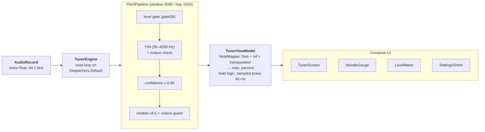

# Tune the World

A free tuner for Android. No ads, no tracking, no account. The app has no internet permission, so nothing you play ever leaves your phone.

It listens through the microphone, detects the pitch with a self-written YIN detector, and shows the note together with its deviation on a needle gauge. It works with any instrument or voice from about 30 Hz to 4200 Hz, from the low B of a five-string bass to the top of the piccolo. By default it shows the sounding (concert) pitch. For transposing instruments you can set the transposition in semitones, and the tuner then shows the written note.

## Features

- Note name with octave, large and readable, plus the measured frequency in Hz.
- Deviation as a signed percentage of a semitone (1 % = 1 cent), shown as a number and on a needle gauge from −50 % to +50 %, with green/yellow/red zones at ±5 % and ±15 %.
- Any transposition from −24 to +26 semitones (default 0, concert pitch). That covers everything from glockenspiel (−24) through trumpet and clarinet in B♭ (+2), horn in F (+7), alto sax (+9), guitar and double bass (+12) and tenor sax (+14) to bass saxophone and contrabass clarinet (+26). The settings show which note a written C4 sounds as, for example B♭2 for tenor sax.
- Adjustable reference pitch A4 from 400 to 480 Hz in 1 Hz steps (default 440 Hz).
- Input level meter, plus an adjustable sensitivity gate from −60 to −30 dBFS (default −40 dBFS), so quiet instruments can be detected and noisy rooms ignored.
- UI in English or German, switchable in the app. Note names follow the language: German uses B and H, English uses B♭ and B.
- The last note stays on screen, greyed out, for 0.8 s after the tone ends.
- The screen stays on while tuning, and the microphone is released when the app goes to the background.
- Reference pitch, transposition, gate and language are saved and survive restarts. A tenor or alto mode chosen in version 1 carries over as +14 or +9.

## Status

Version 1 is feature-complete and has been checked on the emulator and on a real device. The level meter and adjustable gate are the most recent addition.

| Area | State |
| --- | --- |
| Note mapping, note names | Done, unit tested |
| YIN pitch detector, RMS, median smoothing with octave-jump guard | Done, unit tested |
| Pitch pipeline, checked against 42 real recordings of 12 instruments | Done, unit tested |
| Audio input (`AudioRecord`) and tuner engine | Done |
| Settings (DataStore) | Done, unit tested |
| ViewModel and Compose UI (tuner screen, gauge, level meter, settings sheet, permission screen) | Done |
| Emulator check (host audio routed through a virtual PipeWire microphone) | Done |
| Testing on a real device | Done, works as expected |

`./gradlew test` runs 41 unit tests in 9 test classes, and all of them pass.

Known gaps:

- `applicationId` is `de.example.tunetheworld`, which still uses the placeholder `de.example` prefix.
- Release builds are not minified and no signing config is set up.

Out of scope for now: playing a reference tone, strobe display, pitch history, and landscape layout.

## How it works



- **Audio source:** `UNPROCESSED` if the device supports it, otherwise `VOICE_RECOGNITION`. It never uses `MIC`, because that often turns on noise suppression and automatic gain control.
- **Pitch detection:** YIN in plain Kotlin with no Android dependencies ([YinPitchDetector.kt](app/src/main/java/de/example/tunetheworld/dsp/YinPitchDetector.kt)). It searches 30–4200 Hz. Two additions to plain YIN keep it on the right octave:
  - A dip is only accepted if it is within 0.1 of the deepest dip. Otherwise a shallow dip at half the period can win on high notes (clarinet B♭6).
  - For lags of 100 samples or more (below about 440 Hz), it checks twice the lag. If the raw difference there is less than a fifth, that is taken as the period. This catches low notes whose second harmonic is much louder than the fundamental, which is common on low strings and the saxophone's low register. It is not used for short lags, because there the period falls between whole samples and twice the period can look deeper by chance.

  `detect()` allocates nothing. The level gate checks both ends of the analysis window, so a note's first blocks are not analysed while the window still holds the silence before it.
- **Smoothing:** a median over 5 values. A jump of more than 0.8 semitones is ignored, unless three consecutive values agree on it, in which case it counts as a real note change ([PitchSmoother.kt](app/src/main/java/de/example/tunetheworld/dsp/PitchSmoother.kt)).
- **Note math:** `m = 69 + 12·log2(f / ref)`. The nearest sounding note is `n = round(m)` and the deviation is `(m − n) · 100` %. The transposition is added after rounding, and the reference pitch always means concert A4 ([NoteMapper.kt](app/src/main/java/de/example/tunetheworld/music/NoteMapper.kt)). All calculation uses the pitch class index (0–11). The name comes from [NoteNames.kt](app/src/main/java/de/example/tunetheworld/music/NoteNames.kt) only at display time, because "B" means different notes in German and English.
- **Tuning constants** are all in [TunerConfig.kt](app/src/main/java/de/example/tunetheworld/engine/TunerConfig.kt).

### Project layout

```
app/src/main/java/de/example/tunetheworld/
  MainActivity.kt      AppCompatActivity, permission switch
  audio/               AudioInput (AudioRecord wrapper)
  engine/              TunerEngine, TunerConfig
  dsp/                 YinPitchDetector, PitchSmoother, PitchPipeline, SignalUtils (Android-free)
  music/               NoteMapper, NoteNames, Transposition (Android-free)
  data/                SettingsRepository (DataStore), TunerSettings
  ui/                  TunerViewModel, TunerScreen, NeedleGauge, LevelMeter, SettingsSheet, PermissionScreen
app/src/main/res/      strings in values/ (English) and values-de/ (German)
app/src/test/          unit tests, AiffReader test helper
```

## Building

Requirements: JDK 17 or newer (the Gradle daemon toolchain is set to 21) and an Android SDK with API 37. Point `local.properties` at the SDK (`sdk.dir=...`), or open the project in Android Studio.

| | |
| --- | --- |
| Build tooling | Gradle 9.4.1, AGP 9.2.1, Kotlin 2.2.10 |
| SDK | `minSdk 26`, `targetSdk 36`, `compileSdk 37` |
| Dependencies | AndroidX (Compose Material 3, Activity, AppCompat, Lifecycle, DataStore), Kotlin Coroutines, JUnit 4 |

```sh
./gradlew assembleDebug        # build the APK
./gradlew installDebug         # install on a connected device or emulator
./gradlew test                 # run unit tests (no device needed)
./gradlew lintDebug            # run Android lint
./gradlew ktlintCheck          # check Kotlin code style
./gradlew ktlintFormat         # fix Kotlin code style where possible
```

Git hooks in `.githooks/` run these checks. Enable them once per clone with `git config core.hooksPath .githooks`.

- **pre-commit** runs ktlint and Android lint. Lint treats warnings as errors. Warnings that already existed are listed in `app/lint-baseline.xml` and ignored.
- **pre-push** runs the unit tests.

ktlint uses the Android Studio code style (see `.editorconfig`), with Composable functions allowed to start with a capital letter.

The app needs the `RECORD_AUDIO` permission. On first launch it explains why and asks for it. If permission was permanently denied, it links to the system app settings.

## Tests

The unit tests run on the JVM and need no device:

- `NoteMapperTest`, `NoteNamesTest`, `TranspositionTest`: frequency to note and percent with and without transposition, German/English names, the key and the sounding note of a written C.
- `YinPitchDetectorTest`: pure sines from 31 Hz to 4186 Hz (within 1 cent up to 1000 Hz, 3–5 cents at the top), sax-like and low-string tones with a weak fundamental that must not be detected an octave high, noise, silence, and a runtime budget.
- `PitchSmootherTest`, `SignalUtilsTest`, `PitchPipelineTest`: smoothing, octave guard, RMS and dB conversion, and gate behaviour.
- `SettingsRepositoryTest`: defaults, clamping, migration of the version 1 modes, and fallback for unknown stored values.
- `SampleValidationTest`: runs 42 recordings from the [University of Iowa Musical Instrument Samples](https://theremin.music.uiowa.edu/MIS.html) through the full pipeline. There are usually three notes per instrument (low, middle, high), from double bass C1 (32.7 Hz) to violin E7 (2637 Hz). The instruments are alto sax, double bass, cello, violin, flute, B♭ clarinet, trumpet, horn, tenor trombone, tuba, bassoon and oboe, bowed and plucked strings included. Each recording is checked in concert pitch and in its instrument's usual transposition. The test splits every note into three phases:
  - **Attack:** the first 300 ms. Only the onset time is checked, because the sound itself is still settling: overblown flute notes speak in the octave below for a moment, and low brass slides into the pitch.
  - **Settled part:** judged strictly. It must show the right note and octave in at least 95 % of blocks, have no octave errors, stay within ±50 cents in the median, and change by at most 3 cents per block in the median.
  - **Release:** the note has fallen more than 12 dB below its peak (20 dB for plucked notes). Low strings lose their fundamental as they die away, so readings an octave up are tolerated there and listed in the report.

  The test prints a measurement table for each file. The alto sax D3 recording really does jump up an octave briefly (confirmed by ear), so the test allows that one short stretch.

The recordings are not part of the repository. Their site says they "may be downloaded and used for any projects, without restrictions". They are listed with their SHA-256 hashes in [app/src/test/resources/samples.tsv](app/src/test/resources/samples.tsv), which both the test and the `downloadSamples` task in [app/build.gradle.kts](app/build.gradle.kts) read. To add a recording, add a line there. Before the tests run, the task downloads any missing files (about 32 MB in total), checks their hashes, and stores them in `~/.gradle/caches/tunetheworld-samples/iowa-mis/`. Once they are cached, no network access is needed. The directory is passed to the tests through the `samples.dir` system property. If the download fails, the build fails rather than skipping the test.

## Testing on the emulator

The emulator can be fed audio from the host through a virtual PipeWire microphone, which leaves the host's default input untouched:

1. Create a virtual microphone with `pw-loopback`: a sink `saxsink` and a source `saxmic`.
2. Start the emulator with a visible window and `-allow-host-audio`, with `PULSE_SOURCE=saxmic` and `PULSE_SERVER=unix:/run/user/1000/pulse/native` set. A headless emulator (`-no-window`) cannot open an audio driver and only receives silence.
3. Run `adb emu avd hostmicoff`, then `hostmicon`, then play a file with `pw-cat -p --target saxsink <file>`. The host microphone bridge only passes about 4–5 s of audio after each toggle and then delivers silence, even if playback continues. So toggle before every note and check the screen within about 2 s.

The emulator uses the `VOICE_RECOGNITION` source (no `UNPROCESSED`), and its latency says nothing about real devices.

## Constraints

The project follows these rules:

- No GPL or LGPL libraries (in particular no TarsosDSP). Only Apache-2.0 AndroidX, Compose, Coroutines, DataStore and JUnit.
- No NDK, C++ or Oboe. DSP code is plain Kotlin and unit-testable.
- Code and comments are in English. All visible text lives in string resources and is kept up to date in both languages.
